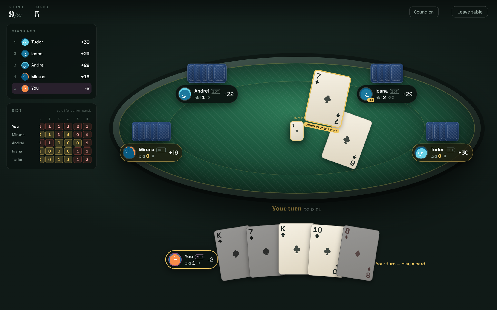

# Romanian Whist

An online version of Romanian Whist, the trick-taking card game where you bid exactly how many tricks you'll take and lose points for every one you miss by. Three to six players share a table in real time, empty seats are filled by bots, and the server deals every card.

**Play it:** [whist-game-two.vercel.app](https://whist-game-two.vercel.app)



The practice table at `/demo` needs no account. You pick a table of 3 to 6, and bots fill the other seats. The whole game runs in the browser.

## How the game works

Each round, every player is dealt a hand and bids how many tricks they'll take. The deck is cut down to fit the table (8 cards per player), and hand sizes follow a fixed plan: N rounds of 1 card, then 2 up to 7, N rounds of 8, back down to 2, and N more rounds of 1. A four-player game is 24 rounds.

- The last player to bid can't choose the number that makes the bids add up to the hand size, so someone at the table always misses.
- You have to follow suit. If you can't, you have to play a trump, though any trump will do.
- Hitting your bid exactly scores 5 plus the tricks you took. Missing costs one point per trick you were off.
- Five exact bids in a row earn a +10 bonus, and five misses in a row cost 10.
- Finishing the game on exactly 0 wins outright, regardless of anyone else's score.

The host can also turn on blind rounds. In the 1-card rounds you hold your card to your forehead: you can see everyone else's card but not your own.

The full rules, including the tie-breaks, are on the in-game rules page.

## Features

- Real-time multiplayer rooms joined with a six-digit code, using Supabase Realtime
- Bots that bid from an estimate of their hand and then play to make that bid, ducking tricks once they have enough
- Seat recovery: if a player disconnects, a bot covers their seat after 15 seconds, and they take it back mid-round when they return
- A contract tracker on each player's plate showing tricks bid, tricks taken and whether they've gone over
- A side panel with standings and every player's bid and result for each round, so streaks are easy to follow
- A live marker on whichever card is currently winning the trick
- Layouts for desktop and for phones in both portrait and landscape, with tap-to-select then tap-to-play on touch screens
- Card sounds synthesised with the Web Audio API, so there are no audio files to load
- Email and Google sign-in

## Architecture

```
my-react-app/                 React client (deployed to Vercel)
  src/game/                   the game engine: pure JavaScript, no dependencies
  src/components/game/        table, lobby, and the hooks that drive them
supabase/
  functions/game/             Edge Function (Deno) that runs every move
  functions/_shared/game/     generated copy of the engine for the function
  migrations/                 schema, RLS policies, triggers
```

### One engine, two runtimes

The rules live in `src/game` as a pure state machine. Each move takes a state and returns a new one, with no I/O and no hidden randomness, so the same code runs in two places. In the browser it powers the offline practice table. On the server, the `game` Edge Function loads the current state, applies the player's move, and writes the result.

The Edge Function can't import from the client folder, so `npm run sync:engine` copies the engine across, and a test fails if the two copies ever differ.

### The server is the authority

Clients never decide anything. They send moves like "bid 2" or "play the 9 of spades" to the Edge Function. The function takes the player's identity from their auth token, checks the move with the engine, and saves the new state. The browser checks legality too, but only to grey out cards you can't play.

Concurrent moves are handled with optimistic concurrency. Each game row has a version number, and a write that loses the race is dropped. The losing client gets the correct state over Realtime a moment later.

### Hidden information is enforced by the database

Game state is split across two tables:

- `games.state` holds everything public: bids, tricks taken, scores, trump, and how many cards each player has. It's broadcast to the table over Realtime.
- `hands` holds the cards, one row per seat per round. Row-level security only lets you read your own row.

Blind rounds flip that policy, so you can read every hand except yours. Doing this in Postgres rather than in React means your own card never reaches your browser, and it can't be found in the network tab.

### Bots and presence

Bots run on the server too. The client decides when to ask for a bot's move, which spaces bot plays out so people can follow them, and the server decides what the bot plays. Every client in the room sends a heartbeat. When a player has been silent for 15 seconds, the server lets a bot play their seat. The server checks the timestamp itself, so a client can't mark another player absent.

## Tech stack

| Layer | Tools |
| --- | --- |
| Frontend | React 19, React Router 7, Vite 6, plain CSS |
| Backend | Supabase: Postgres with row-level security, Auth, Realtime, Edge Functions (Deno) |
| Auth | Email and password, Google OAuth |
| Testing | Vitest, 128 tests |
| Hosting | Vercel |

## Running locally

You'll need Node 20 or newer and a Supabase project.

```bash
cd my-react-app
npm install
cp .env.example .env    # then fill in your Supabase URL, anon key and Google client ID
npm run dev
```

The practice table at `http://localhost:5173/demo` works without any backend setup. For multiplayer:

1. Run the files in `supabase/migrations/` in order in the Supabase SQL editor.
2. Deploy the Edge Function with the Supabase CLI:
   ```bash
   npm run sync:engine          # from my-react-app/
   supabase functions deploy game
   ```
3. To use Google sign-in, create an OAuth client in Google Cloud, enable the Google provider in Supabase, and add your site's URL to both.

Only the anon key belongs in `.env`. The service role key stays inside the Edge Function, where Supabase injects it.

## Scripts

Run these from `my-react-app/`:

| Command | What it does |
| --- | --- |
| `npm run dev` | Start the dev server |
| `npm test` | Run the test suite |
| `npm run lint` | Run ESLint |
| `npm run build` | Build for production |
| `npm run sync:engine` | Copy the engine into the Edge Function |

## Testing

The tests cover the engine: deck sizes, the round plan for every table size, bidding and card legality, trick resolution, scoring and streaks, the zero rule and its tie-breaks, and complete simulated games. A second group of tests checks what each seat is allowed to see, including blind rounds, and confirms that the view built from server data matches the offline one card for card.
